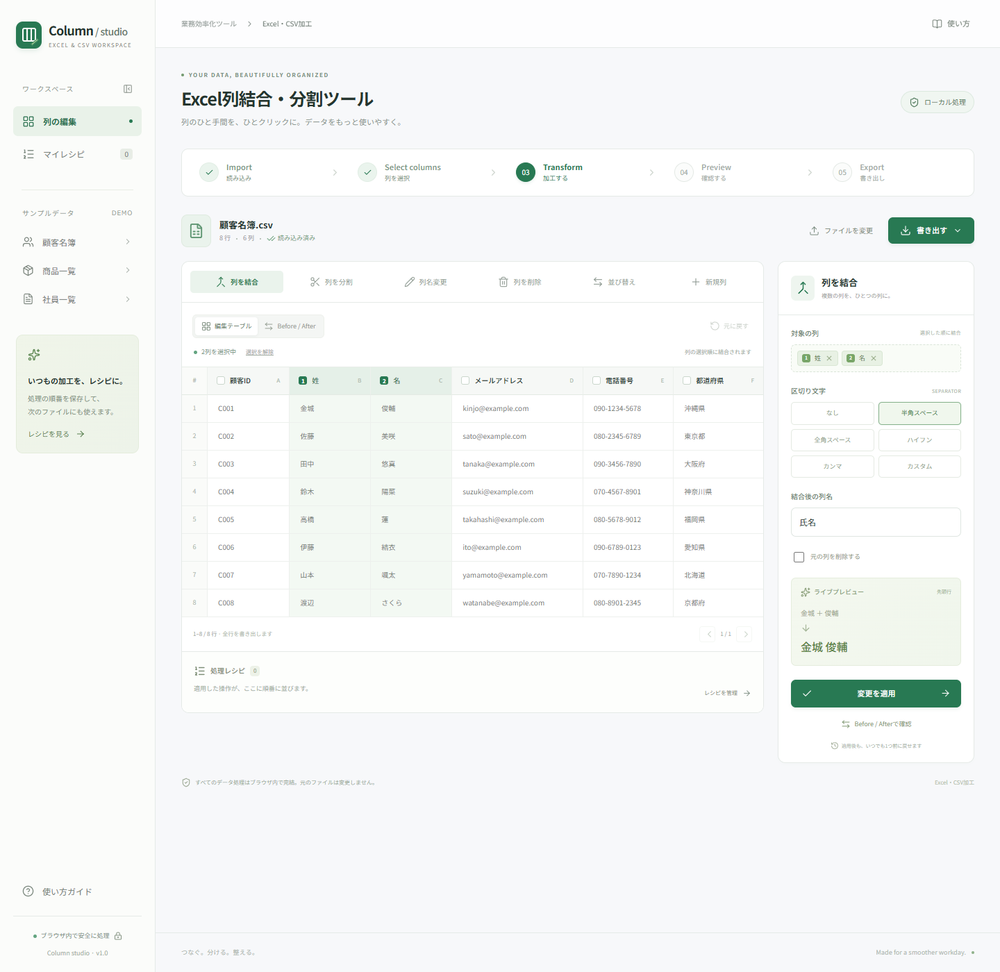
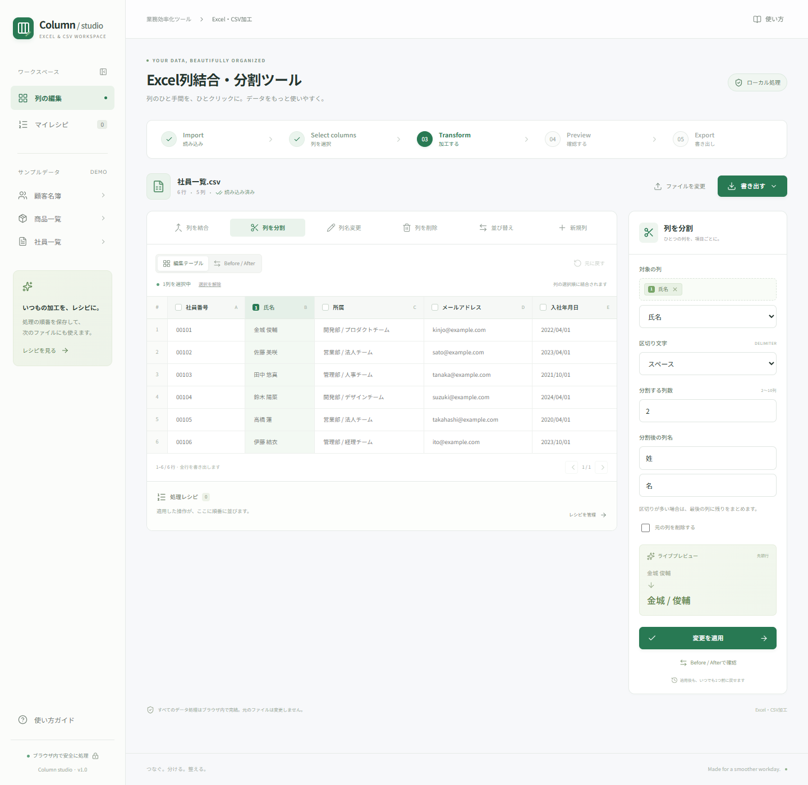
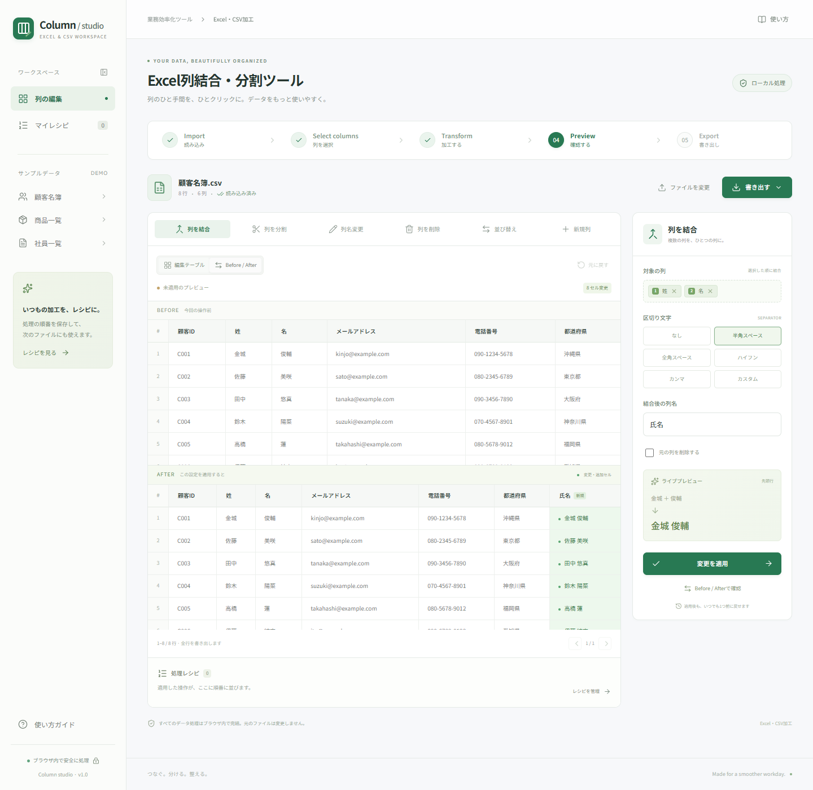

# Excel列結合・分割ツール

Excel・CSVの列を、コードや数式を書かずに結合・分割・並び替えできるWebツールです。ファイルの読み込み直後に表を表示し、列を選択して加工、変更の比較、CSV・XLSXのダウンロードまで一つのワークスペースで行えます。

- カテゴリ：**業務効率化ツール**
- サブカテゴリ：**Excel・CSV加工**
- アプリ：[Excel列結合・分割ツール](https://excel-column-merge-split-tool.vercel.app)
- GitHub：[shunsoco-stack/excel-column-merge-split-tool](https://github.com/shunsoco-stack/excel-column-merge-split-tool)
- [検証記録](docs/QA.md) / [ポートフォリオ掲載用・完全版プロンプト](docs/PORTFOLIO_ADD_PROMPT.md)

公開・動作検証・Secret Scanの結果は[検証記録](docs/QA.md)にまとめています。

## 使い方

```text
Import → Select Columns → Transform → Preview → Export
読み込む → 列を選ぶ → 加工する → 結果を確認 → 書き出す
```

1. CSV・XLSXを選択、またはドラッグ＆ドロップします。読み込みが完了すると、そのまま表が表示されます。
2. 表の見出しをクリックして列を選びます。結合する列は選択順に番号が付きます。
3. 加工方法と区切り文字、列名などを設定します。入力に合わせてライブプレビューが更新されます。
4. Before / Afterで確認して「変更を適用」。操作を取り消すには「元に戻す」を押します。
5. 「書き出す」からCSV・XLSXを選んでダウンロードします。

「顧客名簿」「商品一覧」「社員一覧」の架空デモを使えば、ファイルの準備なしで操作できます。

## 加工機能

| 操作 | 内容 |
| --- | --- |
| 列結合 | 2列以上を選んだ順番で結合。3列以上にも対応 |
| 結合区切り文字 | なし・半角スペース・全角スペース・ハイフン・カンマ・カスタム |
| 列分割 | 1列を指定した区切り文字で分割し、それぞれの列名を設定 |
| 分割区切り文字 | スペース・カンマ・ハイフン・スラッシュ・カスタム |
| 分割数 | 画面では2〜10列を指定。余った内容は最後の列へ保持 |
| 列名変更 | 選択した列の名前を変更。空欄・重複名は検出 |
| 列削除 | 複数列をまとめて削除。最低1列は保持 |
| 列並び替え | 矢印で列の順番を変更し、適用前に確認 |
| 新規列 | 列名と全行に入れる固定値を指定。空欄での追加も可能 |

例えば「姓：金城」と「名：俊輔」を半角スペースで結合すると「金城 俊輔」になります。結合・分割時は、元の列を残すか削除するか選択できます。スペースによる分割は半角・全角スペースの連続を区切りとして扱います。

## Preview・Undo・Recipe

設定中は、適用前の表と設定を反映した表を比較できます。適用後は、読み込み時の表と現在の表を比較します。新しい列・変更セルを背景色、マーカー、ラベルで表示し、削除列も確認できます。

「変更を適用」するたびに操作を履歴へ追加します。Undoは直前の操作を取り消し、保持した原データから残りの操作を再適用します。元ファイルを上書きしません。

複数の操作を順番に登録し、名前を付けてレシピとしてブラウザへ保存できます。レシピのJSON書き出し・読み込み・削除にも対応します。

```text
姓と名を結合 → 電話番号列を削除 → 列を並び替え
```

レシピは同じ列名・順序を持つファイルでの再利用を想定しています。異なる列構成では適用できない場合があります。保存対象は操作設定で、入力ファイルやデータ行は保存しません。ただし、レシピ名、列名、区切り文字、新規列に入れる固定値は設定に含まれます。

## 入出力と制限

| 項目 | 対応範囲 |
| --- | --- |
| 入力 | CSV / XLSX、ファイル選択・Drag & Drop |
| ファイルサイズ | 最大10 MiB（画面表記10MB） |
| データ量 | 最大20,000データ行・100列 |
| 見出し | 先頭行を列名として使用。空欄・重複名には名前を補完 |
| CSV読込 | UTF-8（BOM有無）・Shift_JIS、カンマ区切り、引用符・セル内改行 |
| XLSX読込 | ブック内のシートを選択して加工 |
| 表示 | 10行ずつページング。出力対象は全行 |
| CSV出力 | UTF-8 BOM付き、引用符・カンマ・改行をエスケープ |
| XLSX出力 | 加工済みデータを「加工データ」1シートへ、文字列セルとして出力 |

XLSXは表示される値を読み込みます。書式・数式そのもの・マクロ・画像・結合セル構造・他シートの再現や数式の再計算には対応しません。数式は保存済みの結果がある場合にその値を扱います。パスワード保護されたブック、XLS、ODSには対応しません。

CSV出力では、数式と解釈される可能性がある先頭文字を持つ文字列に単一引用符を付けます。XLSXは文字列セルとして出力し、数式を生成しません。電話番号や商品コードの先頭ゼロを保持するため、出力時に数値へ変換しません。

未適用の設定はダウンロードへ含めません。入力データと編集結果はメモリに保持され、ページの再読み込みや終了で失われます。レシピは保存したブラウザで利用できます。処理速度はファイルの内容や端末性能に依存し、大容量の処理中は画面が応答しにくくなる場合があります。

## Local-first

ファイル読込、変換、比較、CSV・XLSX生成をブラウザ内で実行します。入力ファイルやセル値を送るバックエンドAPI、データベース、アカウント登録、生成AIは使用しません。アプリの配信にはネットワークが必要です。レシピのブラウザ保存には`localStorage`を使用します。

## 実装

```text
Next.js App Router / Static Export
└─ Workspace（React Client Component）
   ├─ ファイル取込・列選択・操作設定
   ├─ Table / Before・After / 操作履歴
   ├─ レシピ保存・JSON読込
   └─ CSV・XLSXダウンロード

src/lib/engine.ts  列ID・入力検証・非破壊変換・レシピ再適用
src/lib/files.ts   Papa Parse / SheetJSによるファイル入出力
src/lib/demos.ts   顧客名簿・商品一覧・社員一覧の架空デモ
```

技術構成はNext.js 16、React 19、TypeScript、Papa Parse、SheetJS 0.20.3、Lucide React、Vitestです。余白、情報階層、明確な選択状態、短いフィードバックを重視したUIを、apple-design Skillを参考に設計しています。

## 開発と検証

Node.js 22以上とnpmを使用します。

```sh
npm ci
npm run dev
```

開発画面は`http://localhost:3017`です。

```sh
npm run lint
npm run typecheck
npm test
npm run build
npm run secret-scan
node scripts/secret-scan.mjs --self-test
```

`npm run verify`でもlint、型検査、単体テスト、build、Secret Scanをまとめて実行できます。`output: "export"`を使用するため、build成果物は`out/`です。Productionではこの静的成果物を配信します。ローカルで本番ビルドを確認する場合は、build後に`npm start`を実行します。

ブラウザテストは開発サーバーを起動した状態で`npx playwright install chromium`、`npm run test:e2e`の順に実行できます。実ファイルの読み込み、CSV/XLSXのダウンロード結果、レシピ、モバイル表示を検証します。

GitHub Actionsでlint・型検査・単体テスト・build・Secret Scanを実行します。

Secret Scanは公開候補のテキストと機密ファイル名を調べる補助検査です。依存ファイル、生成物、バイナリなどは除外し、検出時に値を出力しません。Gitの過去履歴やスクリーンショットの内容は、このスクリプトの対象外です。

## スクリーンショット

### 1. Import

ファイルのドロップ領域と、すぐに試せる3種類のデモ。


### 2. Column Merge

列見出しから姓と名を選び、区切り文字と結合後の値を確認。



### 3. Column Split

区切り文字・分割数・分割後の列名を指定して列を分割。



### 4. Before / After

処理前後の表を比較し、新規列・変更セル・操作履歴を確認。



### 5. Export

適用済みの行数・列数を確認し、CSV・XLSXをダウンロード。


画像の取得環境とGitHub Web UIでの表示確認は[検証記録](docs/QA.md)に記録します。
